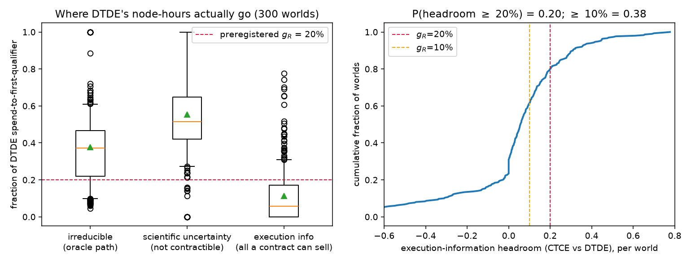

# Findings 1–2 re-evaluation: is the setup wrong if the ceiling can't hit g_R?

Question (2026-09-08): do the headline results mean something in the
setup is wrong, if even the full-information ceiling rarely achieves the
demanded speedup?

Answer, measured on 300 base-card worlds (`diagnose_ceiling.py`,
simulated units): **the simulator is not broken; the preregistered R
metric is priced against an uncertainty no contract can trade.** The
suspicion is half right: there IS a setup error, and it is in the
*metric design*, not the dynamics.

## The decomposition

`nh_first(DTDE) = irreducible + science_gap + exec_gap`, where

- **irreducible** — a *nature oracle* that knows which candidates truly
  qualify and every cost/failure draw, and runs the minimum admissible
  F1→F4 ladder on the cheapest qualifier with per-attempt optimal
  configs. No information contract can beat it.
- **science_gap** = nh_first(CTCE-P0) − oracle — spend caused by not
  knowing *nature* (which candidate qualifies). CTCE-P0 pools everything
  R and H know, but neither party knows nature, so **no R↔H disclosure
  can recover this component.**
- **exec_gap** = nh_first(DTDE) − nh_first(CTCE-P0) — spend caused by
  the parties not sharing what they *do* know. This is the entire
  tradable surface of any information contract.

| component | mean | median | q10–q90 |
| --- | ---: | ---: | --- |
| irreducible | 0.376 | 0.373 | 0.098–0.609 |
| science gap (not contractible) | **0.553** | 0.515 | 0.273–1.000 |
| exec gap (all a contract can sell) | **0.032** | 0.056 | −0.314–0.310 |

P(exec_gap ≥ 20%) = **0.20**; P(exec_gap ≥ 10%) = 0.38. The
preregistered g_R (20% fewer node-hours to first qualifier) demands
savings larger than the whole tradable surface in 80% of worlds. That is
why the ceiling "fails": the metric asks the contract to buy back
scientific luck.

## What information exchange CAN move

The execution layer responds exactly as theory says it should:
labels-per-node-hour ratio (CTCE vs DTDE) mean **1.22** (median 1.14),
≥ 1.15 in **49%** of worlds. Fixed per-attempt overhead is not the
culprit at prior scale (6–7% of spend).

## Revised findings 1–2

1. *(revised)* The MRD infeasibility at the 0.90 threshold is real but
   has a sharper cause than "R's margin binds": **g_R is defined on a
   discovery-time quantity that is 55% scientific noise.** Any
   discovery-time reservation gain above ~10% will fail for every
   contract, in every topology, at any disclosure level — including
   full information. This is a metric-calibration fact, not a simulator
   bug and not evidence that coordination is worthless.
2. *(revised)* CEDT-P4 remains the minimal viable contract, but its
   advantage should be negotiated and audited on **execution-layer
   metrics** (valid labels per node-hour, failure rate, cost per
   completed ladder), where the ceiling shows real, purchasable
   headroom (~15–22% mean uplift). See ../governance_regrade/ for the
   re-grades under this renegotiation.

Caveats: single (base) prior card; the oracle is a lower bound that
obeys ladder rules but ignores contention-avoidance scheduling; CTCE
shares party knowledge only (by design — that is the point).
