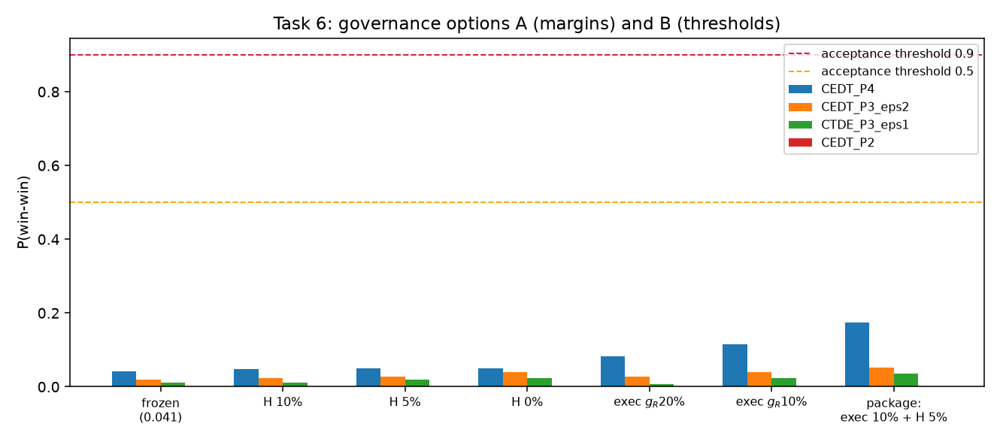

# Task 6: both governance options, tried and graded

Both governance options for task 6 are tried and analyzed (2026-09-08).
The two options were (A) relax the H margin and
(B) lower the 0.90 win-win acceptance threshold. Pure re-analysis of the
1,000-world hard-cap grid (`regrade_governance.py`); simulated units.

## Option A — relax the H reservation margin

| scenario | best contract | P(win-win) |
| --- | --- | ---: |
| frozen (H needs +15% labels/nh, fail +0.02) | CEDT-P4 | 0.041 |
| H margin 10% | CEDT-P4 | 0.047 |
| H margin 5% | CEDT-P4 | 0.049 |
| H margin 0% (any non-regression) | CEDT-P4 | 0.049 |
| fail tolerance 0.02 → 0.04 | CEDT-P4 | 0.041 |

**Relaxing H buys almost nothing** (0.041 → 0.049), because the binding
constraint is R's discovery-time gain, which the ceiling diagnosis
(../ceiling_diagnosis/) showed is priced against non-contractible
scientific noise.

## Option B — lower the acceptance threshold

Under the frozen metrics, **no contract is acceptable at any threshold
down to 0.50** (best = 0.041). Lowering the bar without fixing the
metric does not rescue the protocol; it only certifies a contract that
fails nine worlds out of ten.

## The package the diagnosis recommends (exploratory)

Re-expressing g_R on the execution layer (labels/nh — the quantity
information exchange can actually move) changes the picture more than
either option alone:

| scenario | CEDT-P4 P(win-win) |
| --- | ---: |
| exec-layer g_R = 20% | 0.083 |
| exec-layer g_R = 10% | 0.115 |
| **package: exec g_R = 10% + H 5% + fail 0.04** | **0.175** |

## Analysis

1. Neither option A nor option B, alone or combined, makes any contract
   acceptable — the win-win probability is capped near 0.05 by the
   frozen R metric, and near 0.18 even under the renegotiated package.
2. The residual cap after renegotiation is **prior width, not
   mechanism**: in half the prior worlds even the full-information
   ceiling has <15% execution headroom. A 0.90 *prior-predictive*
   requirement over an ambiguity set this wide is unattainable for any
   contract; the paths forward are (i) collapse the prior with
   measurements (the 81-job pilot now running is exactly that
   instrument), then re-grade on the posterior, or (ii) preregister
   acceptance on posterior-predictive probability after a pilot, not on
   prior-predictive probability.
3. Combined with the sociability map (../sociability_map/): the lever
   that actually moves feasibility is **task scale** (win-win peaks at
   ×10–×300 of measured cost), which is a portfolio/design choice, not
   a margin negotiation.

## Addendum (same day): the posterior path was executed and it works

After the 81-job pilot measured the previously unidentifiable
parameters (../pilot/results/PILOT_RESULTS.md), the posterior re-grade
(`../pilot/posterior_regrade.py`, 300 worlds per scale) gives:

| scale | frozen metrics | renegotiated package |
| --- | ---: | ---: |
| ×10 | CEDT-P4 = 0.070 | CEDT-P4 = **0.713** |
| ×100 | CEDT-P4 = 0.190 | CEDT-P4 = **0.817** |
| ×300 | CEDT-P4 = 0.203 | CEDT-P4 = **0.813** |

Every other contract remains ≈ 0 (leakage-excluded or gain-starved).
Measurement + metric renegotiation together move CEDT-P4 from 0.041 to
0.82 — still short of 0.90, with the residual driven by the parameters
the pilot could not pin (inter-node scaling beyond one box, contention
under real co-tenancy, task-family transfer). A 0.90 acceptance now
looks *reachable but not yet reached*; the next measurement that matters
is scale-validation (../scale_validation/) and, eventually, multi-node
benchmarks off grn061.
