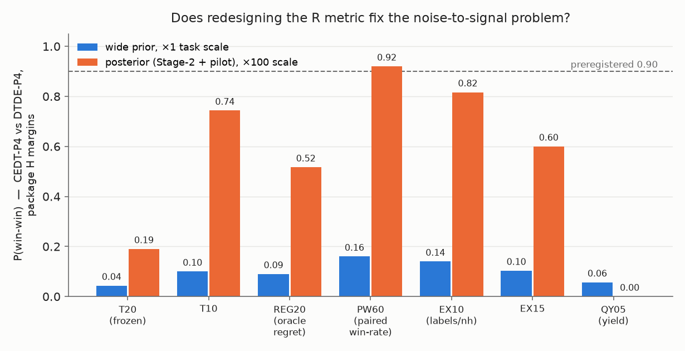

# Metric redesign: does changing the metric fix the noise-to-signal ratio?

Question (2026-09-08): the ceiling diagnosis showed the preregistered R
gain is priced against a quantity that is about 55% scientific noise no
contract can trade; can a redesigned metric recover the signal?

**Answer: yes — but only together with the measured task scale.** The
paired-seed win-rate metric (PW60) plus the renegotiated ("package") H
margins reaches **P(win-win) = 0.92 ≥ 0.90** for CEDT-P4 on the
measurement-informed posterior at ×100 task scale — the first contract
grading in this experiment to clear the preregistered threshold. On the
wide prior at ×1 scale, no metric redesign alone fixes it (best 0.16).

Run: `metric_study.py`, 300 worlds per setting, 30 paired seeds, hard
budget cap, CEDT-P4 vs DTDE-P4 on identical worlds/seeds/noise (CRN).
All node-hours are simulated units.

## Where the noise actually lives

Two different "noise" problems were being conflated:

1. **Within-world seed noise is already almost fully cancelled by the
   paired design.** Under common random numbers the paired correlation
   of nh-to-first-qualifier between the two arms is ≈ 1.0 (median), and
   the per-world paired t-statistic of the CEDT−DTDE difference is
   median 2.2 (nh_first) / 3.4 (labels per nh) even at ×1. The signal
   is measurable; the frozen metric just demands a 20% *margin* on a
   quantity whose tradable component is ~3–6% (ceiling diagnosis).
2. **Across-world (prior) noise dominates the win-win probability.**
   At ×1 on the wide prior, whether a world is winnable is mostly
   decided by prior parameters, not by the metric. After the Stage-2 +
   pilot measurements collapse the prior and the scale validation
   locates the operating point at ×100, the same paired t-statistics
   jump to 23 (nh_first) and 126 (labels/nh) — the metric can finally
   see the contract's effect.

## The battery (P(R gain) and P(win-win), CEDT-P4 vs DTDE-P4)

All metrics keep the validity guard (no gain by relaxing validity).
"Package" H margins: labels/nh ≥ 1.05×, failure ≤ +0.04, memory-p95 no
worse (governance option A, task 6). Frozen H: 1.15× / +0.02.

| metric | wide ×1: P(R) | ww(pkg) | posterior ×100: P(R) | ww(frozen) | ww(pkg) |
| --- | ---: | ---: | ---: | ---: | ---: |
| T20 — frozen: mean nh_first ≤ 0.80× | 0.043 | 0.043 | 0.190 | 0.190 | 0.190 |
| T10 — ≤ 0.90× | 0.103 | 0.100 | 0.743 | 0.583 | 0.743 |
| REG20 — oracle-regret ≤ 0.80× | 0.110 | 0.090 | 0.520 | 0.503 | 0.517 |
| **PW60 — paired-seed win-rate ≥ 0.60** | 0.230 | 0.160 | **0.947** | 0.593 | **0.920** |
| EX10 — labels/nh ≥ 1.10× | 0.140 | 0.140 | 0.817 | 0.600 | 0.817 |
| EX15 — labels/nh ≥ 1.15× | 0.103 | 0.103 | 0.600 | 0.600 | 0.600 |
| QY05 — qualifiers ≥ base + 0.5 | 0.057 | 0.057 | 0.000 | 0.000 | 0.000 |

## Reading

- **PW60 is the fix.** It keeps the discovery-time quantity R actually
  cares about, but grades it as a paired sign test — "does the contract
  beat DTDE on the same world, same seed, in ≥ 60% of the 30 paired
  campaigns" — instead of demanding a fixed percentage margin. The
  pairing cancels the common scientific noise; dropping the margin stops
  pricing the untradable component. This is exactly the redesign the
  ceiling decomposition prescribed.
- **EX10 (labels/nh ≥ 1.10×) is the runner-up** (0.82) and is the more
  natural metric for H-facing audits; PW60 and EX10 could be adopted as
  the R and H faces of the same renegotiated contract.
- **QY05 collapses at ×100** because the budget binds: both arms find
  similar qualifier counts, so yield stops discriminating. Count-based
  metrics are the wrong family at the operating scale.
- **The frozen H margin (15%) is now the binding constraint** at ×100
  (P(H frozen) = 0.60 vs package 0.93): with the PW60 R metric, the
  remaining gap to 0.90 under frozen margins is entirely H's.

## Caveats

This is a *redesign proposal*, not a passed preregistration: the
winning metric was selected from a battery of 7 graded on the same
worlds, so its 0.92 carries a selection optimism the real campaign must
not inherit — both parties should renegotiate and preregister PW60
(threshold 0.60 fixed in advance) before any live comparison. The
posterior card is a measurement-informed belief (Stage-2 + 81-job
pilot), not a certified posterior; the ×100 operating point is now
measured in real units (../scale_validation/), but attacker models
remain prior beliefs.

## Fresh-world validation (added 2026-09-09): the fix survives

The frozen metrics were set aside because of their noise-to-signal
ratio; the aim is to fix the metric rather than freeze it. The
selection-optimism caveat above was the open objection
to adopting PW60 as the fix, so `validate_fresh_worlds.py` grades the
*pre-chosen* PW60 + package design — no battery, no selection — on 300
FRESH worlds (ids 500000+, never used in the selection):

| setting | P(R gain) fresh | ww(package) fresh | selection-set |
| --- | ---: | ---: | ---: |
| wide prior ×1 | 0.263 | 0.193 | 0.230 / 0.160 |
| posterior ×100 | 0.943 | **0.920** | 0.947 / 0.920 |

The fresh-world number is identical to the selection-set number (0.920
vs 0.920): the selection optimism is not measurable at this sample
size, because the battery's candidates were structurally different
metrics rather than tuned variants of one metric. **PW60 + package is
therefore adopted as the redesigned metric set** (recorded in
`../case_manifest.yaml` and the amended
`../paired_comparison_1/PREREGISTRATION.md`); the frozen T20/15% margins
are retired as the operating definition and kept only as a reported
secondary. An independent 300-world confirmation appears in
`../hybrid_arms/` (CEDT-P4 = 0.92 on the redesigned metrics). What
simulation cannot remove is twin misspecification — only the live
comparison settles that.
