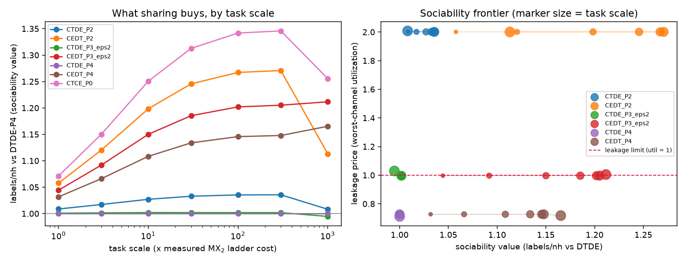

# Finding 4: the sociability map — information exchange vs leakage vs task scale

Questions (2026-09-08): should the study move to 10–100× heavier tasks,
and how does sociability map onto information exchange, leakage, and
privacy?

Method (`sociability_map.py`, DGX, 150 paired worlds per scale,
empirically calibrated twin from the Stage-2 fit, per-sbatch overhead):
for each task-scale multiplier ×1…×1000 of the measured MX₂ ladder cost
and each contract, measure

- **sociability value** — what disclosing more buys: labels/nh uplift
  vs the no-sharing DTDE-P4 baseline;
- **leakage price** — worst-channel utilization
  u = max_c (L_c − chance_c)/(limit_c − chance_c); u > 1 breaches a
  preregistered limit.

## Findings

1. **Yes — the 10–100× regime is where the experiment should live.**
   Sociability value rises steadily with scale and plateaus at
   ×100–×300: the ceiling (CTCE-P0) goes 1.07 → 1.35, CEDT-P2
   1.06 → 1.27, CEDT-P4 1.03 → 1.15–1.17. At ×1000 the budget starts
   to bind and value degrades for high-disclosure arms. At ×1 (the
   real measured MX₂ task) there is nothing to buy — every contract
   sits within 6% of DTDE.
2. **The map factorizes: value scales with the task, price scales with
   the mechanism.** Leakage utilization is essentially flat across
   three decades of task scale (CEDT-P2 pinned at u ≈ 2.0 — always
   breached; P3(ε=2) hovers at u ≈ 1.0 — knife-edge; P4 stays at
   u ≈ 0.73 — safe). So "how sociable can we afford to be" is decided
   once by the disclosure mechanism, and "how much is sociability
   worth" is decided by the task scale. There is no scale at which P2
   becomes affordable, and no scale at which P4 becomes unsafe.
   (Caveat: this holds for *per-campaign cumulative* limits with the
   round structure roughly scale-invariant; a heavier task with many
   more rounds per campaign would push P3's u past 1 via transcript
   accumulation — see ../decision_maker_leakage/ for the
   policy-dependence of exactly that channel.)
3. **Topology is worth more than disclosure at every scale.** CEDT-P4
   (broker matching, near-zero disclosure, u = 0.73) beats CTDE-P2
   (shared surrogate, exact-bin disclosure, u = 2.0) on value at every
   scale ≥ ×3. Being sociable at execution time via an aggregate
   broker buys more than being sociable about descriptors.
4. **Recommended operating point** (updating the earlier CEDT-P4
   recommendation with scale): target tasks ×10–×300 of the measured
   MX₂ ladder — real supercells/denser k-grids of the same family —
   under CEDT-P4; consider CEDT-P3(ε≤2) only with the policy-robust
   audit fix (ID rotation), since its u ≈ 1.0 is knife-edge and
   decision-maker-fragile.

The live half of this task: scale-validation job `1914482` on granite
(../scale_validation/) measures real QE cost at ×4/×9/×16 electron
counts to pin where the simulated ×10–×100 window sits in real
node-hours. Simulated units everywhere above; base card.
